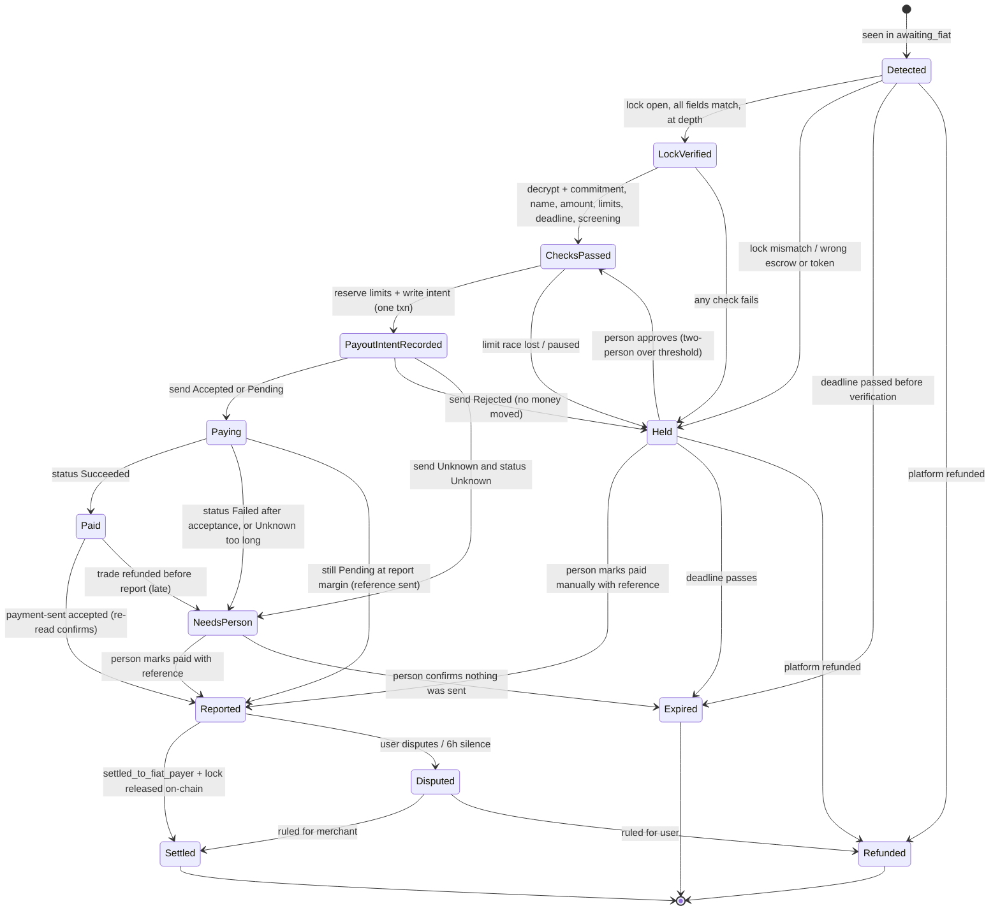

# Merchant Agent: design note

How the agent is built and why: its components, the trade lifecycle, the
store, the threat model and how each security invariant is enforced. It
was written before the code and kept in step with it; where they differ,
the code wins. For a security review, read [`security.md`](security.md)
first.

The Merchant Agent is a service a licensed fiat merchant runs on their own
infrastructure. It pays out naira cash-outs through the merchant's own bank
rails. RecoilPay never sees bank details and never holds the merchant's bank
credentials.

Paths such as `crates/…` or `handlers/…` that are not in this repository
refer to the RecoilPay aggregator, which the agent talks to over its API.

---

## 1. (Internal)

The review of the aggregator's code this design was checked against is
kept in RecoilPay's own repository.

## 2. How the platform behaves

**What does `payment-sent` change?**
`on_payment_sent` requires `awaiting_fiat`. It moves the trade to
`awaiting_confirmation`, sets `deadline_at = now + 6 h`
(`USER_CONFIRMATION_WINDOW_MINS = 360`), and on a cash-out stores
`payment_reference`. The write is guarded on the previous state: if the
trade moved meanwhile, the call returns 409 `TRADE_MOVED`, and in a wrong
state it returns 409 `TRADE_STATE`. Nothing else changes. No money moves,
and nothing on-chain happens.

**What does the user's confirm window look like after that?**
The user has 6 hours to `confirm` or `dispute`.
- `confirm` → `settled_to_fiat_payer`. The payout worker then releases the
  escrow to `solver_address`, the merchant's registered wallet, minus the
  lock's `protocolFee`.
- `dispute` → `disputed`, with no clock. An admin rules with
  `/solver-api/fiat-trades/{id}/resolve`.
- **Silence never pays the merchant.** When the 6 hours run out, the trade
  goes to `disputed`, not to settlement (`on_deadline_passed`: "a person's
  silence never releases their own escrow").
- A user may also `confirm` while still in `awaiting_fiat`, before the
  merchant reports.

**What happens on a late payment?**
The payment window is 15 minutes (`SOLVER_PAYMENT_WINDOW_MINS`), counted
from the moment the lock is recorded (`on_funded`). If `payment-sent` hasn't
been accepted by then, the resolver moves the trade to `refunded_to_funder`,
and the payout worker returns the whole lock to the user. That counts as a
**no-pay** (`fiat_standing.rs`). Three no-pays in 7 days suspend the
merchant's fiat quotes until an admin clears them. A `payment-sent` that
arrives after the refund gets 409 `TRADE_STATE`. Claims against the bond are
user-only (`fiat_claims.rs`: `require_role(… fiat_receiver …)`). So **a
merchant who pays late has no recourse on the platform**. The user has both
the naira and the USDC, and the merchant must recover the money off-platform.
This is why invariant 6 matters.

**What does `GET …/fiat-trades` return? Is there pagination? Can one trade
be fetched by id?**
A bare JSON array of every trade the operator ever had, newest first by
`created_at`, optionally filtered by `state`. There is no pagination, cursor
or `updated_since`, so the cost grows with the merchant's history (P1 fixes
that). Fetching one trade by id: yes, `GET /api/v1/fiat/trades/{id}`, which
is public and needs no key.

**Does `GET …/fiat-payee-key` return the public key?**
Yes: `{ "publicKey": "0x04…" }`, lower-cased. At start-up the agent derives
the public key from its private key and refuses to run if the two differ.

**What does the heartbeat store, and does anything act on it?**
It stores `operators.last_active_at`, and nothing acts on it. P2 would make
it a dead-man's switch.

**How heavy are `oif-types` and `oif-service`? Decision.**
- `oif-service` pulls in `oif-storage` (sqlx/Postgres behind a feature),
  `oif-adapters`, five Solana SDK crates, `tokio` "full", alloy signer
  crates and `regex`. Too heavy, and it carries the
  aggregator's whole runtime.
- `oif-types` with default features avoids Solana and sqlx, but still pulls
  in `reqwest`, `dashmap`, `rand`, `uuid`, `utoipa` (optional) and `aes-gcm`,
  and its DTOs are deliberately lenient. Unknown fields are ignored, and
  `proof` is free-form JSON.

**Decision: copy, don't depend.** The agent gets its own small, strict
versions of the few pure functions it needs, each pinned to the aggregator
by a shared test vector that both sides run:

| Copied into the agent | Pinned by |
|---|---|
| `PayeeIdentity::new`, `canonical`, `commitment` | `test-vectors/fiat-payee.json` → `commitments`, `invalid` (exists) |
| Envelope open and payee-key derivation (new in Rust) | `test-vectors/fiat-payee.json` → new `sealed` and `payeeKey` arrays (M2), checked by Rust and the kit |
| `trade_id_hash`, `lock_id` | new `test-vectors/fiat-lock.json` (M4), checked by an aggregator test and an agent test |
| `parse_rate`, `fiat_minor_exponent`, `price_offramp`, `ProtocolFee::on` | new `test-vectors/fiat-pricing.json` (M7), checked by an aggregator test and an agent test |

Reasons:
1. A merchant must build the agent without the aggregator's source. The
   repo is private, and merchants will get a signed image.
2. The agent must be stricter than the aggregator: it fails closed on
   unknown fields, while the aggregator tolerates them.
3. A shared vector catches drift on either side at CI time, which is the
   same rule the app and the kit already follow.

The aggregator-side vector tests are small test-only additions to
`crates/types`. No `cargo fmt`, no behaviour change.

**How do `rate`, `fiat_minor_units`, `asset_minor_units` and
`fee_minor_units` relate?** This is the formula invariant 3 depends on.

From `open_fiat_trade`, `ProtocolFee::split` and `FiatQuote::price_offramp`:

```
L  = trade.asset_minor_units            // the whole lock
P  = floor(L × bps / 10_000)            // RecoilPay's fee, on the asset
C  = L − P                              // what the merchant converts
(R, s) = parse_rate(trade.rate)         // "1520.50" → R = 152050, s = 2
d  = asset decimals (USDC: 6)
e  = fiat minor exponent (NGN: 2)

gross = floor(C × R × 10^e / 10^(d + s))      // checked u128 arithmetic
fee   = fee_fixed + ceil(gross × fee_bps / 10_000)
net   = gross − fee                           // must be > 0
min_fiat ≤ gross ≤ max_fiat

trade.fiat_minor_units = net
trade.fee_minor_units  = fee
trade.rate             = quote.rate (copied as text)
```

`fee_fixed`, `fee_bps`, `min_fiat` and `max_fiat` are **not on the trade**.
They belong to the quote the trade names by `quote_id`, and `PUT` deletes
old quotes, so the agent must keep its own record of every book it has seen,
keyed by quote id (§4.4).

**P has two sources, and they can disagree.** The aggregator prices with its
configured fee (`protocol_fee_for`). The escrow charges the
`protocolFee` it fixed in the lock at lock time, from the contract's
`protocolFeeBps`. If the two differ, the merchant's USDC on release is
`L − lock.protocolFee`, not `C`. So the agent reads `P` **from the lock on
chain**, the 7th word of `locks()`, treated as 0 when the escrow returns
only six. It recomputes `net` from that value. A mismatch means hold.

Worked example: L = 100 000 000 (100 USDC), 50 bps → P = 500 000,
C = 99 500 000. Rate "1520.50" → gross = 15 128 975 kobo (₦151,289.75).
Fees ₦100 + 25 bps → fee = 10 000 + ceil(37 822.4375) = 47 823 →
net = 15 081 152 kobo.

The arithmetic is exact integer maths, so the check is **exact equality**.
There is no tolerance on recomputation. The "tolerance in basis points" from
the prompt is used for something else: checking that the recorded quote's
rate sits within `max_rate_deviation_bps` of the merchant's own reference
rate at the time it was published (§4.4). That is what catches a book the
merchant never set.

## 3. Platform facts that shaped the design

Each item below changed how a part of the agent was built.

1. **No merchant dispute on cash-outs** (M3, M8). The client keeps
   `add_statement_evidence`. When a trade becomes `disputed`, the agent
   attaches its own evidence automatically: a statement with the bank
   reference and the masked account. "Dispute" is removed from the console
   actions for cash-outs.
2. **Declining a trade isn't recorded by the platform.** The merchant's only
   way to refuse a trade is `returnToFunder(lockId)` on-chain, sent from the
   **registered wallet** (the lock's counterparty). Two cases, depending on
   whether the agent does that or does nothing:
   - The aggregator never calls `on_returned_to_funder` outside tests, so
     the trade sits in `awaiting_fiat` until the deadline refunds it.
   - That refund is counted as a **no-pay**, even when declining was
     correct (for example, an envelope that fails its commitment).

   v1 doesn't send `returnToFunder`. That needs the wallet key; see the
   `Signer` seam. It holds the trade and alerts. **New platform gap P5:** a
   "decline" route that records a no-fault return and doesn't count as a
   no-pay.
3. **One-trade read already exists** (M3, P4). `GET /api/v1/fiat/trades/{id}`
   is public. P4 is reduced to "expose the quote terms on the trade". That's
   optional, because the agent keeps its own history.
4. **Pausing rewrites the book** (M8, invariant 11). There is no per-quote
   pause route. The agent pauses with one `PUT` of an **empty book**. That
   always validates, and withdraws everything at once. The agent keeps the
   last book locally, so `resume` (with approval) can republish it with
   fresh expiries.

   Re-sending the book with `paused: true` was rejected for two reasons:
   one expired quote fails the whole PUT, and every PUT changes the quote
   ids anyway. Open trades are unaffected either way, because they freeze
   their terms at match time.
5. **Payment window detail** (M7). The 15 minutes count from `on_funded`.
   The prompt's "Waiting for lock" state is only on-chain confirmation
   depth, which eats into those 15 minutes. With Base at about 2 s blocks
   and a depth of 5, that's about 10 s. Each chain's depth is configurable,
   and `doctor` warns if depth × block time exceeds 20% of the window.
6. **`PayoutStatus` needs `NotFound`** (M6). Crash recovery has to tell
   "the bank never heard of this key" (safe to send with the same key on a
   rail that guarantees key idempotency) apart from "can't tell" (go to
   Needs a person). The trait becomes `Succeeded | Failed | Pending |
   NotFound | Unknown`.
7. **Per-payee limits need a stable payee tag** (M5, M7, invariant 7). The
   commitment is salted per trade, so the same account has a different
   commitment every time. The agent stores
   `payee_tag = HMAC-SHA256(pepper, canonical identity)`. The pepper is a
   secret in the secret backend. Without it the tag can't be reversed by
   brute force, unlike a plain hash of a 10-digit NUBAN. The deny-list file
   uses the same tag, and `merchant-agent screening hash` converts a list.
8. **Payee key provisioning** (M1, M2). The agent needs the payee private
   key. It's derived from a wallet signature over `payeeKeyMessage`, whose
   text says *"Sign this only on the RecoilPay solver dashboard"*. Signing
   it for the agent, with `cast wallet sign` or a hardware wallet, gives the
   same key but contradicts that sentence. v1 keeps the message unchanged,
   following the no-drift rule. `merchant-agent init` explains this and
   accepts either:
   - the **derived private key**, the recommended option, so the signature
     is never stored. The dashboard has no export today, so this needs a
     small "Export payee key for the Merchant Agent" button in
     `PayoutsPage.tsx`, which doesn't change the derivation; or
   - the **signature**, from which the agent derives the key once and keeps
     only the result.

   Both are secret references; neither is ever a config value. Changing the
   message text needs your call (§9).
9. **E2E** (M10). The existing drivers use live testnets. M10 adds an
   anvil-based run by deploying `AttestedEscrow` from `attested-escrow/` and
   pointing the aggregator at it through `CHAIN_REGISTRY_JSON`, so the
   scenarios need no faucet and no `.env` file.

## 4. Components

```
merchant-agent/                     (separate Cargo workspace)
  crates/agent-core   library: everything testable, no I/O in the logic
    config      strict YAML, validation, modes (sandbox | production)
    secrets     SecretSource trait; file + env now; gcp/aws behind features
    payee       payee key, envelope open, commitment, payee_tag (zeroized)
    aggregator  typed client for the routes in §4.3
    chain       independent lock reader (alloy), pinned addresses, depth
    pricing     quote history + exact recomputation (§2 formula)
    policy      limits, deadline guard, screening, two-person rule
    machine     pure (state, event) -> (state, actions)
    store       SQLite: trades, intents, quote history, lease, approvals, audit head
    rails       PayoutRail trait; simulated, manual, paystack, template
    audit       hash-chained JSON lines
    notify      Notifier trait; webhook, smtp, pagerduty
    console     askama pages + auth (argon2id, TOTP, CSRF)
    metrics     prometheus
  crates/merchant-agent   the binary: CLI + runtime wiring
  crates/tamper-proxy     test-only, never shipped (M10)
```

### 4.1 Main loop

One task with a lease (invariant 10):

1. **Poll:** `GET …/fiat-trades?state=awaiting_fiat` every `poll_secs`
   (default 5). For each trade the agent already knows that isn't in that
   list, re-read it by id to follow it to its terminal state.
2. **Reconcile:** insert new trades as `Detected`, and feed every change
   into the machine as an event.
3. **Advance:** for each trade, run one transition, then do one durable
   write, then perform its actions. A crash between any two steps resumes
   from the last write (§6).

### 4.2 Payout pipeline for one trade

```
Detected
  → lock check (own RPC, pinned escrow + token, depth N, open, all fields)
  → LockVerified
  → checks:
      decrypt + commitment (4) · bank name lookup (4) · recompute net (3)
      · limits + float (5) · deadline margin (6) · screening · pause state
  → ChecksPassed
  → reserve limits + write intent (one SQLite transaction)
  → PayoutIntentRecorded
  → rail.send(key, …): Accepted / Pending → Paying
                       Rejected → Held
                       Unknown  → status(key) → … or NeedsPerson
  → status(key) until Succeeded → Paid
  → payment-sent(reference) → re-read trade → Reported
  → watch: settled_to_fiat_payer + lock released on-chain → Settled
```

The lock is re-read at `latest` immediately before `send`. That narrows,
but can't close, the window for a refund made after payment (§7).

**When to report.** `payment-sent` goes out when the rail reports
`Succeeded`. If the rail is still `Pending` when the time left before
`deadline_at` drops below `report_margin_secs` (default 120), the agent
reports with the bank's reference anyway. The money is committed, and
missing the window would refund the user *and* lose the naira. If a
transfer that was reported still pending later fails, the trade goes to
**Needs a person** with an urgent alert.

### 4.3 Aggregator routes used

| Route | Auth | Used for |
|---|---|---|
| `GET /solver-api/operators/{id}/fiat-trades?state=awaiting_fiat` | `x-api-key` | the queue |
| `GET /api/v1/fiat/trades/{id}` | none | re-read one trade |
| `POST /api/v1/fiat/trades/{id}/payment-sent` | `x-api-key` | report |
| `POST /api/v1/fiat/trades/{id}/evidence` (`statement`) | `x-api-key` | defend a dispute |
| `GET/PUT /solver-api/operators/{id}/fiat-quotes` | `x-api-key` | book history, pause |
| `GET /solver-api/operators/{id}/fiat-payee-key` | `x-api-key` | key check at start-up |
| `GET /api/v1/chains` | none | pinned-address check at start-up |
| `POST /solver-api/operators/{id}/heartbeat` | `x-api-key` | liveness (for P2) |

The rate limit defaults to 1000 requests a minute with a burst of 100. A
5-second poll stays far below that.

**Retrying `payment-sent`.** It's idempotent in effect but not in response:
a repeat after success gets 409 `TRADE_STATE`. So after any error or timeout
the agent re-reads the trade:
- `awaiting_confirmation` with our reference means done.
- `awaiting_fiat` means retry.
- Anything else means Needs a person.

### 4.4 Quote history and the rate check

The agent records every book it sees, either from its own `PUT` responses
or from a `GET` snapshot on every poll. Each quote id maps to its terms and
to the merchant's reference rate at that moment (configured, or from the
`Pricing` seam later).

A trade whose `quote_id` the agent has never seen is **held**. In v1 the
merchant may still publish from the portal, and the agent picks those
quotes up within one poll. A quote published and replaced between two polls
is the one gap this leaves, and it holds rather than pays.

## 5. Payee envelope: exact rules for the Rust side

From `payee.ts`. Every one of these is pinned by vectors in M2.

- Envelope JSON is `{v, alg, epk, iv, ct, tag}`, where every hex field is
  **`0x`-prefixed lowercase** (viem `bytesToHex`).
  - `v` must be `1`, and `alg` must be `"ECIES-secp256k1-AES256GCM"`.
  - `epk` is 65 bytes, uncompressed, `0x04…`.
  - `iv` is 12 bytes.
  - `tag` is 16 bytes.
  - `ct` is non-empty and at most 1024 bytes (the aggregator's
    `validate_sealed_payee`).
- `shared = ECDH(priv, epk)`, compressed, with the first byte dropped,
  leaving 32 bytes of X. Use `k256::ecdh::diffie_hellman(...)
  .raw_secret_bytes()`, which is the X coordinate.
- `key = HKDF-SHA256(ikm = shared, salt = epk (65 bytes), info = "recoilpay/fiat-payee/v1", L = 32)`.
- `AES-256-GCM(key, iv)` decrypts `ct ‖ tag` with no AAD.
- The plaintext is UTF-8 JSON
  `{"v":1,"rail","bank_code","account","name","salt"}`, with `salt` as a
  `0x` + 64-hex string. The payload's `v` must be `1`.
- Identity: run `PayeeIdentity::new(rail, bank_code, account)` (the
  aggregator rules), then require
  `commitment(identity, salt) == trade.payee_commitment`, compared
  case-insensitively. **A mismatch refuses, every time.**
- Name: `normaliseName` is `NFC` → `trim()` → collapse `\s+` to one space →
  non-empty and **at most 140 UTF-16 code units**. JavaScript's `trim` and
  `\s` use the Unicode whitespace set, and `.length` counts UTF-16 units, so
  the Rust code uses `unicode-normalization`, the same whitespace set as
  ECMAScript, and `encode_utf16().count()`. Vectors cover a non-ASCII name,
  a name with a non-breaking space, and a 141-unit name.
- Payee key: `keccak256(b"recoilpay/fiat-payee-key/v1" ‖ solver_id ‖ sig65)`,
  where `sig65` is exactly as signed (`v` = 27 or 28 from `personal_sign`).
  The key must be a valid scalar. The public key is the uncompressed form.

Keccak comes from the `sha3` crate (`Keccak256`), the same one the
aggregator uses for `payee_commitment`.

## 6. Store, lifecycle and state machine

### 6.1 Agent states and the words people see

| Agent state | Console / alert wording |
|---|---|
| `Detected` | Waiting for lock |
| `LockVerified`, `ChecksPassed` | Checking |
| `PayoutIntentRecorded`, `Paying`, `Paid` | Paying |
| `Reported` | Paid, waiting for the customer |
| `Settled` | Settled |
| `Held(reason)` | Held for review |
| `NeedsPerson(reason)` | Needs a person |
| `Disputed` | Customer disputed |
| `Refunded` | Refunded to customer |
| `Expired` | Missed, not paid |

`Expired` means the deadline passed and the agent never sent money.
`Refunded` means the platform returned the lock to the user. A trade can be
`Refunded` after the agent paid; that's the late-payment case, and it is
always alerted as urgent.

### 6.2 Lifecycle



There is no edge out of `PayoutIntentRecorded`, `Paying` or `NeedsPerson`
that calls `send` a second time automatically. Only one restart path may
call `send` again, and only with the **same key**: `status(key) ==
NotFound` on a rail whose `send` is idempotent by key (`rail.idempotent_send()`
returns true for Paystack and simulated, false for the template default).

### 6.3 Idempotency key

`key = "rpma-" + trade.id`. Trade ids are `ft-` plus 32 hex characters, so
the key is 40 characters of `[a-z0-9-]`. Paystack's reference rules are
checked in M11. A person-approved re-pay after a definite `Failed` uses
`"rpma-" + trade.id + "-" + attempt`, with `attempt` ≥ 2, and needs two
approvers.

### 6.4 Schema (SQLite, WAL, `synchronous=FULL`)

```sql
CREATE TABLE trades (
  trade_id          TEXT PRIMARY KEY,
  chain             TEXT NOT NULL,
  quote_id          TEXT NOT NULL,
  asset_minor       TEXT NOT NULL,        -- integer as text, never REAL
  fiat_minor        TEXT NOT NULL,
  fee_minor         TEXT NOT NULL,
  rate              TEXT NOT NULL,
  user_address      TEXT NOT NULL,
  payee_commitment  TEXT NOT NULL,
  payee_tag         TEXT,                 -- HMAC(pepper, canonical); set after decrypt
  account_masked    TEXT,                 -- "******6789"
  bank_recipient    TEXT,                 -- the rail's own recipient ref, if any
  agent_state       TEXT NOT NULL,
  reason_code       TEXT,                 -- hold / needs-person reason
  attempt           INTEGER NOT NULL DEFAULT 1,
  idempotency_key   TEXT UNIQUE,
  bank_reference    TEXT,
  lock_id           TEXT NOT NULL,
  lock_protocol_fee TEXT,
  deadline_at       TEXT NOT NULL,        -- RFC 3339 UTC
  platform_state    TEXT NOT NULL,
  created_at        TEXT NOT NULL,
  updated_at        TEXT NOT NULL,
  version           INTEGER NOT NULL      -- optimistic guard for each write
);

CREATE TABLE payouts (                    -- the write-ahead intent; one per attempt
  idempotency_key   TEXT PRIMARY KEY,
  trade_id          TEXT NOT NULL REFERENCES trades(trade_id),
  amount_minor      TEXT NOT NULL,
  payee_tag         TEXT NOT NULL,
  day               TEXT NOT NULL,        -- merchant-local date, for daily limits
  status            TEXT NOT NULL,        -- recorded | accepted | succeeded | failed | unknown
  bank_reference    TEXT,
  created_at        TEXT NOT NULL,
  updated_at        TEXT NOT NULL
);
CREATE INDEX payouts_day ON payouts(day);
CREATE INDEX payouts_payee_day ON payouts(payee_tag, day);

CREATE TABLE quotes_seen (                -- §4.4
  quote_id TEXT PRIMARY KEY, chain TEXT, asset TEXT, asset_decimals INTEGER,
  fiat_currency TEXT, rail TEXT, rate TEXT, fee_fixed TEXT, fee_bps INTEGER,
  min_fiat TEXT, max_fiat TEXT, reference_rate TEXT, first_seen TEXT NOT NULL
);

CREATE TABLE lease (id INTEGER PRIMARY KEY CHECK (id = 1),
  holder TEXT NOT NULL, fencing INTEGER NOT NULL, expires_at TEXT NOT NULL);

CREATE TABLE approvals (id INTEGER PRIMARY KEY, trade_id TEXT, action TEXT NOT NULL,
  requested_by TEXT NOT NULL, approved_by TEXT, created_at TEXT NOT NULL, decided_at TEXT);

CREATE TABLE control (id INTEGER PRIMARY KEY CHECK (id = 1),
  paused INTEGER NOT NULL, paused_by TEXT, paused_auto INTEGER NOT NULL,
  last_book TEXT);                        -- JSON of the book to restore on resume

CREATE TABLE audit_head (id INTEGER PRIMARY KEY CHECK (id = 1),
  seq INTEGER NOT NULL, hash TEXT NOT NULL);

CREATE TABLE users (...);                 -- console users, M8 (argon2id hash, TOTP secret sealed)
```

The store holds no names, account numbers or bank codes, and no sealed
envelope. The envelope is always re-read from the aggregator when needed.
That's invariant 7.

## 7. Threat model

| Adversary | What they can try | What stops it |
|---|---|---|
| **Compromised aggregator** | Invent trades; inflate `fiat_minor_units`; swap the counterparty or token; point at a fake escrow; replay a settled trade; fake the quote book | The lock is read from the merchant's own RPC on the **pinned** escrow, with counterparty = **pinned** merchant wallet, token = **pinned** USDC, amount = the trade's figure, open, at depth (3). Amounts are recomputed from the agent's own quote history, with `P` read from the lock (3). One payout per trade id, forever (1). Local limits (5). The aggregator can still make the agent pay a **real, correctly locked** trade's committed payee. That is the system working as designed. |
| **Compromised aggregator + attestor key** | Refund the lock to the user after the merchant paid | Not preventable by the agent. Narrowed by the re-read at `latest` just before `send`, by limits, and by an urgent alert on any `Refunded` after `Paid`. Documented as residual risk. |
| **Stolen API key** | Everything an operator key can do: read trades, mark paid, rotate the key, change the payee key, publish quotes, withdraw the fill wallet (only to the registered wallet) | It can't make the agent pay. The agent never pays from aggregator data alone. A changed payee key stops the agent at the next start-up check, and the agent re-checks every 10 minutes. Store the key like a bank credential (15). P3 scopes it. |
| **Stolen host** | Read secrets in memory or on disk; send payouts | Secrets live in a cloud secret manager or a 0600 file, never in config (8). Limits cap the damage per day (5). The kill switch and its alerts (11). The audit chain shows tampering (12). Production needs a cloud KMS for the payee key; documented. |
| **Malicious user** | Seal different details from the commitment; use a name that doesn't match the account; mule accounts; dispute after being paid | Commitment re-check (4). Bank name lookup under a name-match policy (4). Screening and the per-payee daily limit (5). Automatic statement evidence with the bank reference on dispute. |
| **Bank API that lies or times out** | Report success without paying; time out after paying; pay twice on retry | Write-ahead intent with a deterministic key (1). Unknown → `status(key)` → Needs a person, never a blind retry (2). The float balance check catches a bank that claims success without moving money, by reconciling balance deltas (M9 metric plus a daily alert). |
| **RPC that lies** | Report a lock that doesn't exist, or report it open | Optionally require two independent RPCs to agree (4). `eth_chainId` is checked at start-up. Depth confirmation. Disagreement fails closed (13). |
| **Clock skew** | Make the agent start a payout that lands after the deadline | Compare the local clock with the aggregator's `Date` header and the latest block timestamp. Over `max_skew_secs` (default 5) means pause and alert (13). |

## 8. How each invariant is enforced

| # | Mechanism | Main test (named `invariant_<n>_…`) |
|---|---|---|
| 1 | `payouts.idempotency_key` is UNIQUE and written in the same SQLite transaction as the limit reservation, **before** `send`. The machine emits at most one `Send` per (trade, attempt). Restart always calls `status` first. | crash after every step boundary; the simulated ledger holds ≤ 1 payment per trade (M5) |
| 2 | `send` returning Unknown, or a timeout, 5xx or parse error, leads to `status(key)`. If that says `Unknown`, the trade goes to Needs a person. No code path from Needs a person calls `send`. | fault injection "5xx after success" and "timeout" (M6) |
| 3 | Lock read on own RPC against pinned escrow, token and wallet, at depth, with every field compared. Chains are checked against `GET /api/v1/chains` at start-up (mismatch means pause). Exact recomputation from quote history and the lock's `protocolFee`. Rate within `max_rate_deviation_bps` of the reference. | anvil single-field mismatches (M4); tampering proxy (M10) |
| 4 | Decrypt and recompute the commitment, refusing a mismatch. `verify_account` name compared under `name_match: strict | token_set | off(sandbox only)`. When the trade carries the seller's verified name (`payer_name`, on offers that pay only verified sellers), the bank's name must also match it under RecoilPay's shared rule (`vectors/seller-names.json`), unless `require_verified_name_match` is off (sandbox only); `""` (unavailable) always holds. | vectors (M2); name mismatch holds (M6); verified seller names (v0.2.0) |
| 5 | One `BEGIN IMMEDIATE` transaction sums the reserved and paid amounts for the day, for the payee per day, and for the velocity window, then inserts the intent. `balance() − amount ≥ min_float`. Limits must be set explicitly in production. | boundary and concurrent tests (M7) |
| 6 | `deadline_at − now − expected_rail_latency < start_margin_secs` means don't start; alert. | margin boundary (M7) |
| 7 | `OpenedPayee`, `AccountName` and similar types are `Zeroize`, `!Debug`, `!Display`, `!Serialize`. A redaction layer in `tracing`. The store has no PII columns. | grep of logs, audit, DB, alerts and metrics for the test account and name (M5→M10) |
| 8 | Config holds only `gcp-sm://`, `aws-sm://`, `file://` or `env://` references. A file must be mode 0600 and owned by the agent's uid. `env://` is refused in production. | config tests (M1) |
| 9 | Console and health bind `127.0.0.1` by default; anything else needs `console.bind_public: true` and logs a warning. rustls with webpki roots, with no insecure option compiled into release builds. | config test and bind test (M1, M8) |
| 10 | An OS file lock (`flock`) on `agent.lock` in the data volume, **and** the `lease` row with a fencing token that every payout transaction checks. | two instances, one DB (M5) |
| 11 | The `control.paused` flag is checked inside the intent transaction. Pause does a `PUT` of an empty book (§3.4). It never touches `Paying` or `Reported` trades. | pause writes the book; in-flight payouts finish (M8) |
| 12 | `entry.hash = SHA-256(prev_hash ‖ canonical JSON(entry))`, with the head mirrored in `audit_head`. | edit and delete detection (M9) |
| 13 | Strict deserialisation (`deny_unknown_fields`, closed enums), a version check on the envelope, RPC agreement, the skew check, and every DB error mapped to "no payout + alert". | unknown field and state tests (M3) |
| 14 | `Cargo.lock` committed; `cargo deny` and `cargo audit` in CI; crypto only from RustCrypto (`k256`, `aes-gcm`, `hkdf`, `sha2`, `sha3`) plus `zeroize` and `hmac`. | CI (M12) |
| 15 | Documented in `security.md`. `doctor` warns that the key is unscoped until P3. | doc check (M13) |

## 9. Decisions (agreed 2026-11-13)

1. **Strict trade parsing.** The agent rejects unknown fields and states.
   A contract test in the aggregator's CI pins the agent's trade fixture,
   so a change to the trade shape can't ship unnoticed.
2. **Payee key message unchanged.** `init` takes the derived private key
   (recommended) or the signature, as a secret reference. The portal gets
   an "Export payee key for the Merchant Agent" button. The derivation and
   the message text stay as they are.
3. **P5 decline route** is on RecoilPay's platform list: a route that
   records a no-fault return to the user and isn't counted as a no-pay.
4. **Report timing.** Report on `Succeeded`. If the rail is still
   `Pending` when the time left drops below `report_margin_secs`, report
   with the bank's reference anyway.

## 10. Known limits of v1

These go into `README.md` as written:
- no Solana cash-outs
- no on-ramp purchases
- no high availability: one instance, one volume
- no inbound webhooks
- no Tier 1 provider proofs
- no automatic `returnToFunder`
